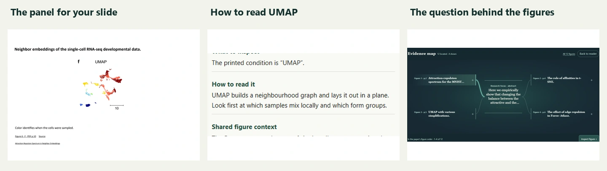

# Reading Desk

[中文](README.md)

You zoom in on a six-panel figure and still don’t know where to look first. Follow one figure through this **43-second screen recording**, from opening a single panel to putting it on a slide with its source.

## Jump to a question

| When you get stuck | What happens on screen |
| --- | --- |
| Six panels. Which one should I look at? | [Open A, then F](https://zhoy0409-debug.github.io/paper-reading-desk/?lang=en#focus) to see two views of the same cells. |
| What does PCA mean in this paper? | [Select the acronym](https://zhoy0409-debug.github.io/paper-reading-desk/?lang=en#context) to see its expansion and the definition on page 7. |
| Where did the authors actually say that? | [Follow the caption back to the PDF](https://zhoy0409-debug.github.io/paper-reading-desk/?lang=en#evidence). The sentence is highlighted on page 10. |
| Do I have to explain the whole figure to ask when the cells were sampled? | [Ask beside the panel](https://zhoy0409-debug.github.io/paper-reading-desk/?lang=en#ask). The source guide answers “0 days to 4 months” and links the caption. |
| Which page did this slide come from? | [Open the exported PowerPoint slide](https://zhoy0409-debug.github.io/paper-reading-desk/?lang=en#slide). Panel F, the speaking note and page 10 are together. |

## Quick start

1. Download the source ZIP from the [latest release](https://github.com/zhoy0409-debug/paper-reading-desk/releases/latest) and extract it.
2. Install Python 3.8 or later. On Windows, run `start.cmd`. On macOS or Linux, run `python3 preview.py` in the extracted directory.
3. Open [Reading Desk](http://127.0.0.1:4187/), choose **English**, then open the sample paper or select your own PDF.

PDF processing and on-device translation run locally. Public literature search uses PubMed and Crossref. Optional model providers receive the text shown in the question panel. To enable DeepSeek or Qwen, set `DEEPSEEK_API_KEY` or `DASHSCOPE_API_KEY` (Beijing endpoint), then restart. A local Ollama model or a signed-in Codex CLI can also be used. The source guide works without a model account.

See [third-party credits](THIRD-PARTY.md) for the sample paper and bundled components.
