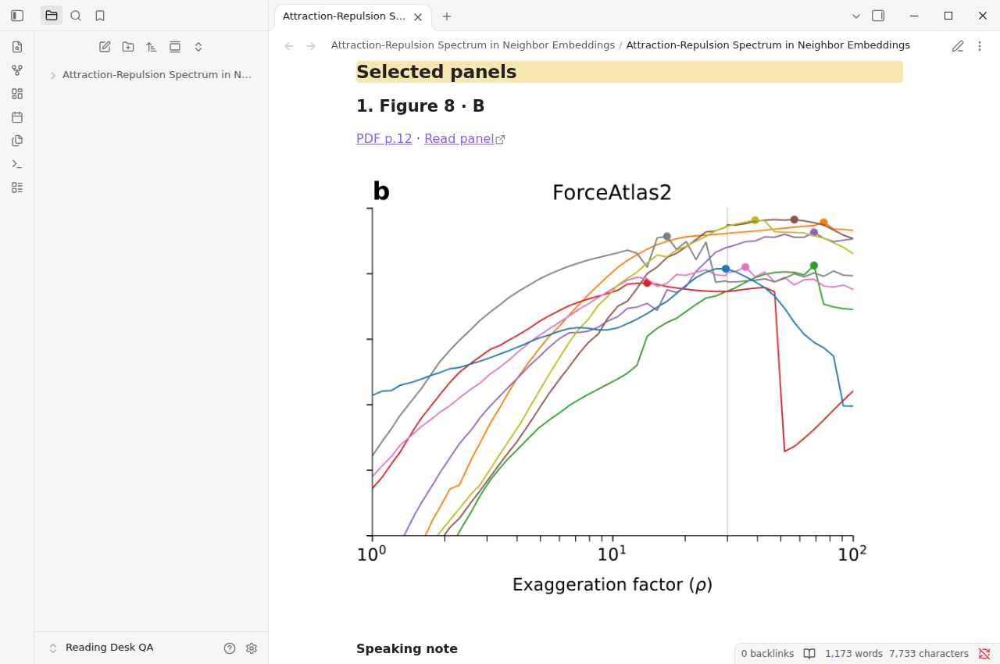
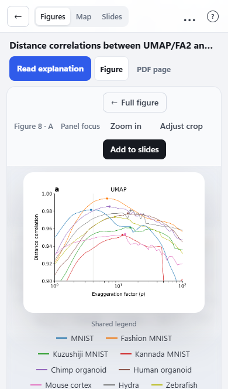
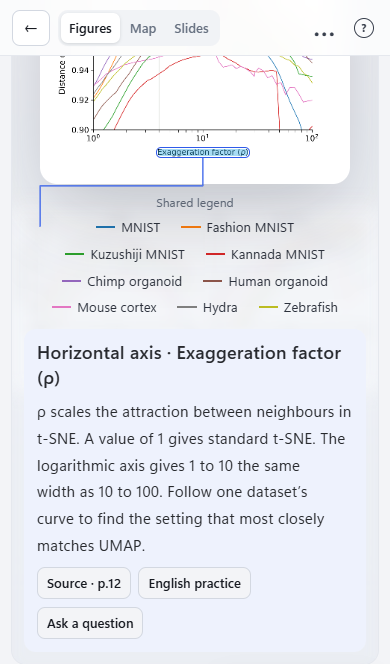
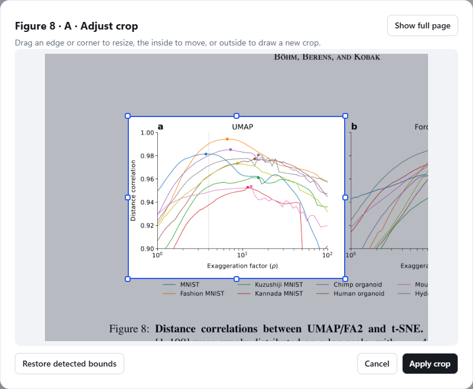
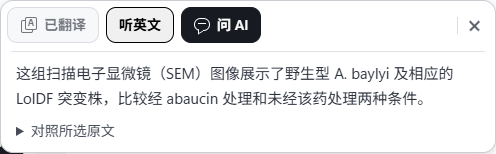
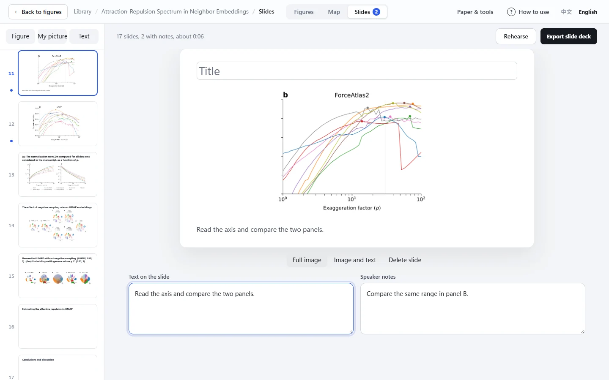
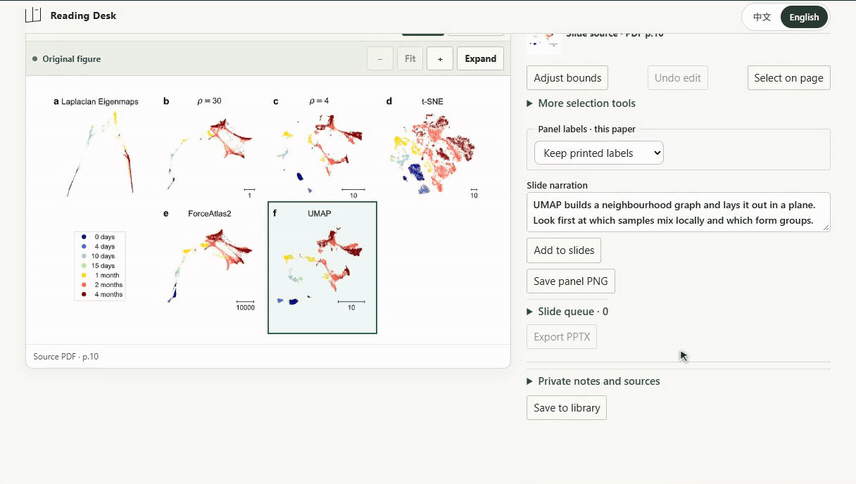
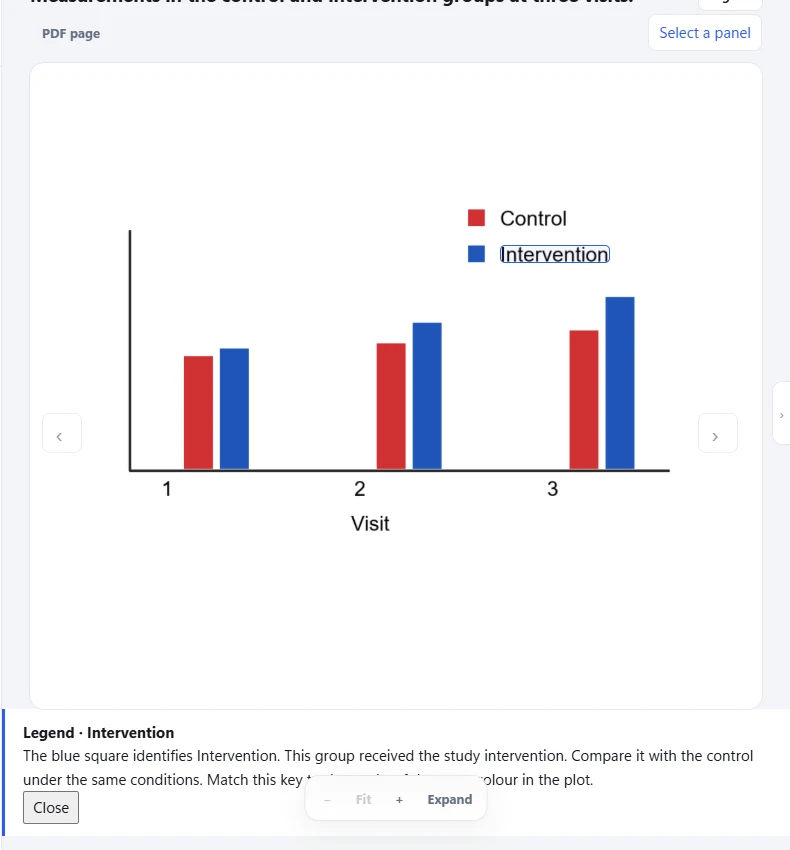
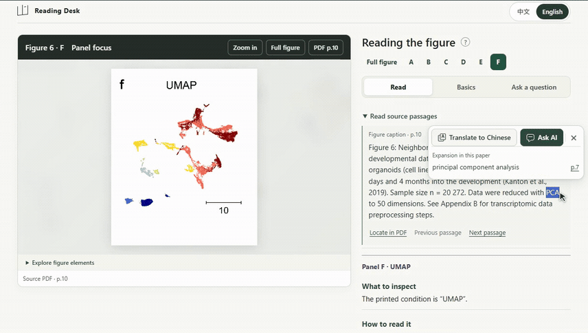
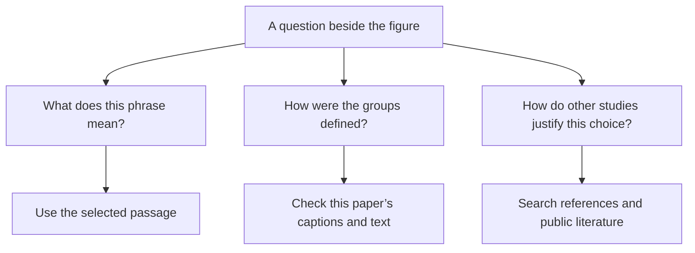

# Reading Desk

[Open the reader](https://zhoy0409-debug.github.io/paper-reading-desk/read/?lang=en) · [打开中文阅读器](https://zhoy0409-debug.github.io/paper-reading-desk/read/?lang=zh) · [Download for Windows](https://github.com/zhoy0409-debug/paper-reading-desk/releases/latest/download/Reading-Desk-Windows-x64.zip) · [中文说明](README.zh-CN.md)

Share the reader link above with your group. It opens without a GitHub account. Refresh the same address for the latest published version.

Select text and choose **Baidu Translate** to translate the selection in a new tab. Publication search accepts a PMID and links to a web search for the same terms. These options need no API key in Reading Desk.

For full-page plates with a legend on a different page, the reader shows both page numbers. References such as “Figure 3A” and “Figures 3A and 3B” link the figure to the passages that discuss it.

The cross-journal upload audit covers 46 PDFs from 38 journals. It checks printed figure numbers, caption and image pages, automatic crops, and the source visible when you open a figure explanation. [See the results by paper](https://github.com/zhoy0409-debug/paper-reading-desk/blob/main/docs/journal-layouts.md)

**To read an explanation**, open a PDF, choose a figure thumbnail and select **Read explanation** beside the figure. The reading draws on the caption and passages that refer to the figure. On a phone, **Back to figure** returns to the same figure or panel. Open **Figure labels** to choose an identified axis or legend, or tap it on the image. These features run in the browser. For an image-only scan without a readable caption, the reader offers page viewing and manual cropping. [Try a labelled figure](https://zhoy0409-debug.github.io/paper-reading-desk/read/?lang=en&sample=figure-8a)

For reviews, the sidebar lists diagrams by their published figure numbers. If labels are embedded in the image, the reader shows its progress. Tap a label while it is being read and its explanation opens when the label is recognized.

Open **Mind map** to see the review’s background, what the authors set out to cover, and any questions or barriers they identify. Select the page number beside a point to check the passage.

Open **Paper & tools → Export to Obsidian** to save a Markdown note with the paper’s background and aims, figure captions, your notes and the slide basket in order. Include the PDF for offline page links and the selected crops for inline images. Choose your vault folder in a supported desktop browser, or extract the downloaded ZIP into your vault. Each export has its own folder, so later exports preserve your edits in Obsidian. The export runs locally without a plugin or API key.

See a reading note opened in Obsidian

Select a detected panel letter or side label to add that panel to your slide basket. For a group of curves or a diagram, use **Select a panel** to draw the region you want to present. The exported note keeps your crop and links back to its PDF page.

After reading another paper in the same browser, **Read panel** in an earlier note returns to its original crop. Take the note folder and its attachments to another device to view the cropped images and PDF pages in Obsidian. The reader stores manual crop settings in the original browser.

On a phone, open the **⋯** menu to find the export. You can also reach it where you write private panel notes. This note links directly to page 12 of the source PDF and displays the panels in the order selected. [Source paper](https://arxiv.org/abs/2007.08902)

See the two taps on a phone

Open <b>Read explanation</b> above the figure. Tap the horizontal axis to read what the exaggeration factor changes.

 

Journal club tomorrow? The axis labels look fuzzy on your slide. You looked up UMAP and lost track of which dots you were comparing. You know what each figure shows, but explaining why one follows another is harder. The walkthrough below uses one published paper to show how to take a panel, read it closely and place it in the paper’s argument.

[Watch by chapter](https://zhoy0409-debug.github.io/paper-reading-desk/?lang=en) · [Watch the narrated introduction](https://zhoy0409-debug.github.io/paper-reading-desk/film/en.html)

Open a panel close-up and choose **Add to slides**. Its thumbnail appears in the **Slide basket** at the bottom of the reader.

Start with the public sample, or drop in your own PDF. Your browser reads the file on your device. [Open Reading Desk](https://zhoy0409-debug.github.io/paper-reading-desk/read/?lang=en)

## How does a figure fit into the argument and into my talk?

Choose **Adjust crop** in a panel or **Crop** on a slide-basket card. Drag an edge or corner to include the axis, legend or scale bar. Apply the crop to update its preview and export.

On desktop, the paper outline, original figure and explanation share one screen. Open a panel for a close-up. A thumbnail below the reading area marks the current panel in the whole figure. Select an axis, legend or scale bar to bring its explanation into view. Scroll through the note to reach its source and follow-up actions.

The map links background, prior findings, open questions and aims to the pages that support them. Select an English caption and choose **Translate to Chinese**. Expand the source to compare the wording, identifiers and numbers.

**Map** organizes the background, research question and figure evidence from the text and captions. Select a page number to check a quotation. With a connected model, the Windows edition can generate an outline directly. The web edition accepts outlines from other AI chats and checks their quotations against the PDF.

Choose **Edit deck** in the basket to work with the same panels, order and notes in a full presentation. Insert your own pictures or text slides, edit the slide body and speaker notes separately, rehearse and choose **Export slide deck**.

## How do I get a sharp panel onto my slide?

Drag a card by its handle to change the presentation order. Type a speaking note beside its thumbnail, then choose **Export selected figures**. The deck follows the basket order, with editable notes below each image and links to the source page. Reopening the same PDF in the same browser restores your selections and notes.

To save a single image, choose **Save panel PNG** under **Crop & present**.

[Watch with playback controls](https://zhoy0409-debug.github.io/paper-reading-desk/?lang=en#export) · [Inspect the exported PNG (1243 × 1500)](dist/media/tour/sample-panel.png) · [Download the editable sample slide](https://raw.githubusercontent.com/zhoy0409-debug/paper-reading-desk/refs/heads/main/docs/guide/figure-6f-en.pptx)

Adjust a crop, relabel panels or show two panels together

- **Correct a boundary.** Adjust the detected crop, undo your edit or draw a new area on the PDF page. If a caption sits on a different page from its figure, the reader shows both page numbers.
- **Bring the legend along.** Keep a shared legend, vertical axis or group heading with your panels so the audience can interpret them.
- **Build a slide queue as you read.** Remove a panel with ×. To reorder with the keyboard, focus its drag handle and press the left or right arrow key. Adjacent panels from the same figure with matching shared annotations appear side by side, up to two per slide. Keep the printed labels or assign new ones for the talk while retaining the original figure reference.
- **Keep speaking notes and private notes separate.** Slide titles and speaking notes are editable in PowerPoint. Each panel is an image. You can attach a public source link. The sample slide links to page 10 of the paper.

## Can I explain each figure before reading its caption?

Pick a figure in the paper outline and turn on **Look first**. The caption, figure title and notes are covered. Write one line, choose **Reveal caption**, and mark whether you got it. If a figure has to be shown as a full page, its printed caption stays visible and the reader says so.

Open **Slides** to arrange and rehearse the deck. Rehearsal has a timer and notes you can reveal on demand.

When you add a panel to the slide basket, your line becomes its speaking note. It stays in step until you edit the note by hand. Notes you typed are never overwritten. Press `?` in the reader for keyboard shortcuts.

## How do I pronounce a term before journal club?

Select an English term or passage and choose **Listen**. From any figure, **English practice** opens its available English explanation for normal or slow playback. To prepare for questions, choose **Explore background & rehearse** to draft an English question with the selected term and figure evidence.

[Hear Jon Stokes say *abaucin*, then rehearse a sentence for your talk](https://zhoy0409-debug.github.io/paper-reading-desk/read/?lang=en&practice=abaucin). The author clip starts around 40:05 in the ACS interview and supports slow replay. Other English words and sentences use device speech, with a dictionary lookup for short terms.

## What am I looking at, and where did the authors say that?

Open a close-up from the figure, a panel letter or the crop thumbnail. Figure elements remain clickable while Crop & present is open. Drawing a boundary brings up the original image. Finish or cancel to resume the close-up.

Open either chart in a side-by-side comparison. Click an axis for its quantity and scale, or click the legend sample or its name to identify the series. On dual-axis charts, the explanation identifies the matching scale. Try uploading [DenseNet, Figure 3](https://arxiv.org/pdf/1608.06993#page=6) or [Deep Networks with Stochastic Depth, Figure 4](https://arxiv.org/pdf/1603.09382#page=9), then check the same label after zooming or adjusting the crop.

Panel 6F is labelled UMAP. Open the panel to learn what each point represents and which groups to compare. Then select the sampling description in the caption and ask, “How long did sampling last?” The source guide finds the interval from day 0 to month 4 and takes you back to the authors’ sentence.

[Watch the UMAP walkthrough](https://zhoy0409-debug.github.io/paper-reading-desk/?lang=en#methods) · [Watch the question and source lookup](https://zhoy0409-debug.github.io/paper-reading-desk/?lang=en#ask)

[Try panel 8A yourself: x-axis, legend and curve maximum](https://zhoy0409-debug.github.io/paper-reading-desk/read/?lang=en&sample=figure-8a)

What happens when I select an axis, group or printed label?

[View the still image](docs/guide/focus-en.png)

- **Explore one element at a time.** In sample panel 8A, select the x-axis to read what ρ changes, a legend entry to identify its dataset, or a peak to find the setting that most closely matches UMAP for that dataset. Click the background or press `Esc` to dismiss it, or return to the whole figure.
- **Read different kinds of evidence.** Guides cover axis units, colors, line styles and the relationship between observations and fitted curves. A curated pathology example shows where to look on a section and how to compare the image with an injury score.
- **Understand the design.** When the paper gives the details, see who or what was studied, which groups were compared and when treatment occurred relative to the event. For covered animal models, open a strain record or studies using the same model.
- **Ask why a choice mattered.** Start from a comparator or outcome and look for a rationale in the methods, a paper the authors cited or another study. Each source can be inspected separately.
- **Choose translation or a follow-up.** Select text for a translation or send a question along with the figure reference. For an acronym, the reader looks for its expansion in this paper. Help is available on hover, keyboard focus or tap.

How much context should I use for a question?

Start at the selected passage and choose the scope that fits your question.

Review or edit the selection, supporting passages and follow-up history before sending them to a model. Public search terms are editable. Results matched to the paper’s bibliography are marked as cited.

## How do these figures fit the paper’s argument?

Open the map at the research question or the authors’ statement of focus. Follow a branch to its figure, expand the available panels and return to the PDF to check the evidence. Switch to Chinese for translated paper titles, figure branches and panel descriptions, or back to English to check the wording.

[Watch the map walkthrough](https://zhoy0409-debug.github.io/paper-reading-desk/?lang=en#story) · [Explore the sample in English](https://zhoy0409-debug.github.io/paper-reading-desk/read/?lang=en)

Open another paper, add a supplement or pick up where you left off

- **Import your paper.** Open PDF, DOCX or TXT, or paste text or a caption. Assign supplements and references separately. Use a PDF for figure crops. Scanned pages can be opened and selected manually.
- **Choose a reading view.** Use the map for the whole paper, panel focus for one result, or the source index to navigate sections, figures and citations. Imported papers use their identifiable layouts, captions and passages. Curated editions also include dedicated method and design explanations.
- **Verify a claim.** The reader labels panel-specific and shared captions separately. A source link opens the PDF page and highlights the matching line when it can be located.
- **Resume reading.** Reopen saved papers, notes and crop positions in the same browser. The private cross-paper map distinguishes matched citations, title-based topic links and connections you record yourself.
- **Reuse literature you looked up.** Public bibliographic records are saved in your browser. The 30-day interval for model-background literature controls when to check for updates. Saved records remain available afterwards.

## Choose an edition

| Capability | Web reader | Portable Windows x64 |
| --- | --- | --- |
| Start reading | Open the site. No installation or account required | Extract the ZIP and double-click `start.cmd`. Python is included |
| English or Chinese maps, panel focus, PNG and PPTX export, source guide | Included | Included |
| Public literature search | Crossref, Europe PMC and PubMed lookup by PMID | PubMed and Crossref |
| Continue in your usual AI chat | Copy the question and excerpts to ChatGPT, DeepSeek, Claude or Gemini | Same options |
| Answers inside the reader | Built-in source guide | Also supports DeepSeek, Qwen (Beijing), an installed Ollama model or a signed-in Codex CLI |
| Get updates | Reopen or refresh the site | From v0.3.0, open **Updates**, download the release and choose **Restart to apply** |

In the Windows question panel, open **Answer and search settings → Connect a model** to enter a provider API key. Keys entered there stay in the service’s memory for the session and can be removed at any time. Provider billing applies. Users of v0.2.2 or earlier need to download the new edition once. [Download for Windows](https://github.com/zhoy0409-debug/paper-reading-desk/releases/latest/download/Reading-Desk-Windows-x64.zip) · [Release notes](https://github.com/zhoy0409-debug/paper-reading-desk/releases)

On macOS or Linux, the local service can also be run from source with Python 3.8+ and `python3 preview.py`.

The walkthrough uses the open paper on neighbor embeddings by Böhm, Berens and Kobak. Figures are cropped and annotated in the reader. [Read the paper](https://www.jmlr.org/papers/v23/21-0055.html) · [Figure credits, licenses and bundled components](THIRD-PARTY.md)
