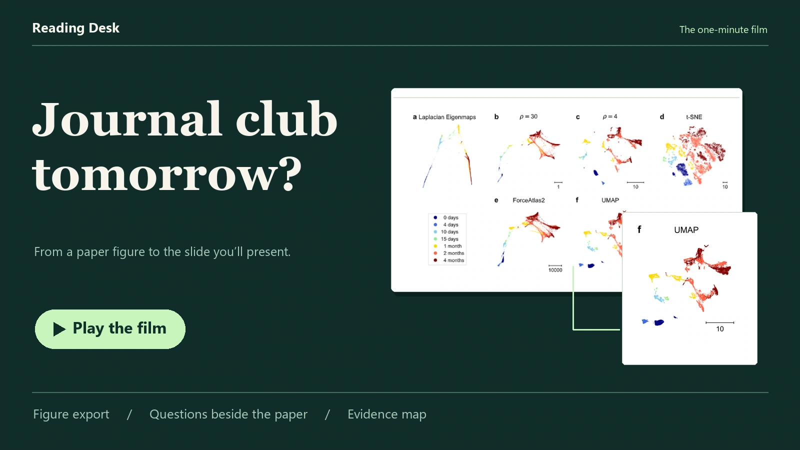
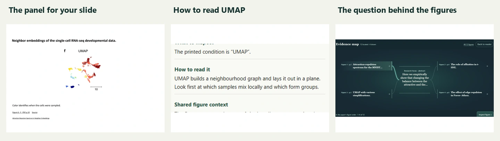

# Reading Desk

[简体中文](README.zh-CN.md) · [Open the reader](https://zhoy0409-debug.github.io/paper-reading-desk/read/?lang=en) · [One-minute film](https://zhoy0409-debug.github.io/paper-reading-desk/film/en.html) · [Watch the tour](https://zhoy0409-debug.github.io/paper-reading-desk/?lang=en)

Preparing a journal club talk? You can spend an evening cropping figures, looking up an unfamiliar method, and trying to explain why Figure 6 follows Figure 5. Open your PDF in Reading Desk and work through those tasks beside the paper.

[Watch the one-minute film](https://zhoy0409-debug.github.io/paper-reading-desk/film/en.html) · [Browse features by reading task](https://zhoy0409-debug.github.io/paper-reading-desk/film/en.html#features)

| When you get stuck | What you can do |
| --- | --- |
| **“I zoom, screenshot and crop every panel. The labels still look fuzzy on my slide.”** | Select the panel once. Save a PNG rendered from the source PDF or add it to a PowerPoint slide with the figure number, page and your speaking note. [Watch the export](https://zhoy0409-debug.github.io/paper-reading-desk/?lang=en#export) · [Inspect the actual 1243 × 1500 PNG](dist/media/tour/sample-panel.png) |
| **“I opened five tabs to learn UMAP. What am I supposed to look for in these dots?”** | Read the method beside the plot and see how to compare local groups. Select PCA to find the authors’ definition, or ask about a detail and jump back to the cited passage. [Watch the method walkthrough](https://zhoy0409-debug.github.io/paper-reading-desk/?lang=en#methods) |
| **“I understand each figure on its own. How do I explain the paper as a whole?”** | Open the evidence map to see the research focus and figures in paper order. Follow a figure to its panels and the authors’ text, then choose the evidence you want to present. [Explore the map](https://zhoy0409-debug.github.io/paper-reading-desk/?lang=en#story) |

## Start reading

**In your browser.** Open the reader and open the sample paper or select your own PDF. Reading, figure export and the source guide work without installing software or creating an account. The browser processes your PDF on your device. [Open Reading Desk](https://zhoy0409-debug.github.io/paper-reading-desk/read/?lang=en)

**Portable Windows edition (x64).** Download the ZIP, extract the whole folder, then double-click **start.cmd**. Python is included. This edition also supports in-reader answers from model APIs and installed local tools. [Download for Windows](https://github.com/zhoy0409-debug/paper-reading-desk/releases/latest/download/Reading-Desk-Windows-x64.zip)

## Ask questions

- **Use the source guide** to ask about an excerpt and return to the page. For background literature, choose a public search. The web edition queries Crossref, and the local edition can also use PubMed.
- **Already use a web AI chat?** Choose **Continue in a web AI chat**, copy your question and excerpts, then paste them into your preferred service. You decide what to send.
- **Want an answer inside the local reader?** In the question panel, open **Answer and search settings → Connect a model**. Select DeepSeek or Qwen (Beijing), paste your provider’s API key and choose **Use key**. The key stays in the local service’s memory until removed or the reader service stops. API access and billing follow your provider.
- **Already have Ollama or Codex CLI?** The local reader detects an available Ollama model or the installed Codex CLI. For Codex, sign in with your own account.

To run the local service from source on macOS or Linux, use Python 3.8+ and run `python3 preview.py`. See [third-party credits](THIRD-PARTY.md) for the paper, figures and bundled components.
