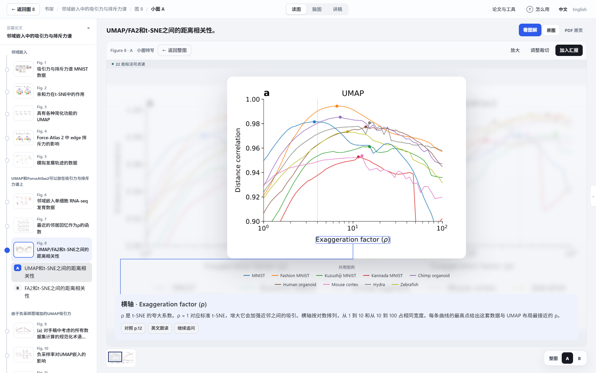

# Reading Desk

[跳到下方中文介绍 ↓](#文献精读)

Preparing a journal club talk? Open a paper, click a figure label to see what it means, and take the panels you want to present straight into PowerPoint. The reader runs in your browser. You can share the same link with anyone, including readers without a GitHub account.

[Open the reader](https://zhoy0409-debug.github.io/paper-reading-desk/read/?lang=en) · [Try a figure before uploading](https://zhoy0409-debug.github.io/paper-reading-desk/read/?lang=en&sample=figure-8a) · [Watch the 60-second walkthrough](https://zhoy0409-debug.github.io/paper-reading-desk/?lang=en)

## From the paper to your presentation

1. **Follow the argument.** Upload a PDF and open **Map**. The black node gives the central scientific question. Follow its branches to see what motivated the study, what the authors set out to learn, and which figures support their findings. Reviews show the scope of the synthesis. Select a page number to read the source.
2. **Understand the figure in front of you.** Select a thumbnail and choose **Read explanation**. Tap a recognized axis, legend symbol or group label. For a protein substitution, the card decodes the letters and position. When the image labels identify the comparison groups, **Ask a question** shows which rows or columns to compare. The source link takes you back to the paper.
3. **Prepare slides without taking screenshots.** Choose **Add to slides** on a panel. In the slide basket, adjust the crop, drag panels into order and edit your speaking notes. Export the deck to PowerPoint or save an individual panel as a PNG.
4. **Keep what you learned.** Export a Markdown note to Obsidian with the selected panels, your notes and links to the PDF pages. For an English-language talk, select an unfamiliar term or a sentence and choose **Listen** to practise it.

[See the study’s aims on its map](docs/guide/studio-map-en.webp) · [Follow Figure 8 to its supporting evidence](docs/guide/studio-map-figure-en.webp)

**Reading in Chinese?** The upload screen suggests a subject glossary. You can choose another field or add your own terms. The glossaries distinguish a drug’s delivery vehicle from a vehicle in a traffic study. If one map entry fails to translate, use its retry button to continue where you were.

For questions about a method or a group, start with the paper’s own caption and text. You can also search the literature or enter your own DeepSeek or Qwen API key to ask a model inside the reader. Confirming a model request uses your own provider account.

The web address stays the same as updates are published. On Windows, you can also unzip the portable edition and double-click `start.cmd`. Python is included.

[English user guide](README.en.md) · [Download for Windows](https://github.com/zhoy0409-debug/paper-reading-desk/releases/latest/download/Reading-Desk-Windows-x64.zip) · [PDF checks across 38 journals](https://github.com/zhoy0409-debug/paper-reading-desk/blob/main/docs/journal-layouts.md)

---

# 文献精读

准备组会时，常常要在原图、图注和正文之间来回翻，最后还要一张张截图做 PPT。把 PDF 放进文献精读，就可以在图旁看解释，把要讲的小图、顺序和讲稿一起带进 PowerPoint。用浏览器打开即可，也可以把同一个网址直接发给没有 GitHub 账号的同学。

[打开中文阅读器](https://zhoy0409-debug.github.io/paper-reading-desk/read/?lang=zh) · [先用一张原图试试点读](https://zhoy0409-debug.github.io/paper-reading-desk/read/?lang=zh&sample=figure-8a) · [看 60 秒操作演示](https://zhoy0409-debug.github.io/paper-reading-desk/?lang=zh)

## 从读懂论文到上台汇报

1. **先理清作者想回答什么。** 上传 PDF，打开「脑图」。黑框点出本文的核心科学问题。顺着分支读研究缘起、作者的具体目的和各张图的证据。综述按讨论范围和主题展开。点页码可回到原句。
2. **在图上弄懂一个具体细节。** 选一张缩略图，点「看图解」，再点小图里的坐标轴、图例或已识别的组名。比如点蛋白变体标签，可以直接读懂字母和位点编号。图中标明了对照组和处理行时，点「继续追问」就能看到该横着比还是竖着比，也可以点页码核对原文。
3. **把要讲的小图直接做成 PPT。** 在小图上点「加入汇报」。在底部汇报篮里调整裁切、拖动排序，直接写下每张图怎么讲。可以导出带讲解备注的 PowerPoint，也可以单独保存小图 PNG。
4. **把读过的内容留下来。** 导出到 Obsidian，把选好的小图、笔记和原文页码放在一起。准备英文汇报时，划选陌生术语或整句，点「听英文」即可跟读。

[看这篇论文的研究目的](docs/guide/studio-map-zh.webp) · [看图 8 和支持它的原文证据](docs/guide/studio-map-figure-zh.webp)

**同一个词，在你的专业里怎么译？** 上传时可自动识别学科，也可手选或补充自己的术语。药物实验里的 *vehicle control* 译为「溶媒对照」。脑图里遇到某条中文没加载出来，点它旁边的「重试此处」，就能留在原位置继续读。

想弄清某个方法或分组的依据，可以先看本篇图注和正文，也可以继续检索相关文献。需要模型回答时，可在「划词追问」填入自己的 DeepSeek 或通义千问 API Key，确认发送后使用自己的模型额度。

网页版更新后，刷新原来的网址即可。Windows 便携版已包含 Python，解压后双击 `start.cmd` 就能打开。

[中文使用指南](README.zh-CN.md) · [下载 Windows 便携版](https://github.com/zhoy0409-debug/paper-reading-desk/releases/latest/download/Reading-Desk-Windows-x64.zip) · [查看 38 种期刊的 PDF 实测结果](https://github.com/zhoy0409-debug/paper-reading-desk/blob/main/docs/journal-layouts.zh-CN.md)
