# 文献精读

[打开中文版](https://zhoy0409-debug.github.io/paper-reading-desk/read/?lang=zh) · [下载 Windows 便携版](https://github.com/zhoy0409-debug/paper-reading-desk/releases/latest/download/Reading-Desk-Windows-x64.zip) · [English](README.md)

把上面的「打开中文版」分享给同学即可直接使用，无需 GitHub 账号。新版发布后，刷新同一网址即可打开新版。

划选文字，点「百度翻译」可在新标签页翻译选段。查公开文献时可以直接输入 PMID，也可用同一检索词打开百度学术。这些入口无需给阅读器配置 API 密钥。

遇到图和图注分居两页的论文，阅读器会分别标出「图像第几页」和「图注第几页」。正文提到 Figure 3A 或 Figures 3A and 3B 时，也能从图 3 回到提及它的段落。

用 38 种期刊的 46 篇 PDF 从上传开始复测。逐图核对 244 张正文图的标题和图解，给有位置参照的 237 张图检查裁切，还从每条关联的正文摘录点回原文。[查看逐篇测试结果](https://github.com/zhoy0409-debug/paper-reading-desk/blob/main/docs/journal-layouts.zh-CN.md)

**想看图解**，打开 PDF，选一张缩略图，点原图旁的「看图解」。这里会列出图注中能找到的比较、测量，以及正文中提到这张图的段落，可点页码核对。手机上点「回到图」就会回到刚才那张图或小图。有可识别的坐标或图例时，直接点图，或从「点读标注」里选。以上操作在浏览器里即可完成。纯扫描页没有可读图注时，可以查看原页、手动框选取图。[用一张真实论文图试试点读](https://zhoy0409-debug.github.io/paper-reading-desk/read/?lang=zh&sample=figure-8a)

读综述时，左栏按原文图号列出示意图。图上的名称如果嵌在图片里，阅读器会显示识别进度。可以先点感兴趣的名称，读到该处时会自动打开对应说明。

打开「脑图」，可查看综述的背景、作者梳理的范围，以及原文明确提出的问题或难点。点击要点旁的页码即可对照原句。

打开 **论文与工具 → 导出到 Obsidian**，可以把论文背景与目的、逐图图注、自己的笔记，以及按汇报篮顺序排列的小图讲解存成 Markdown。勾选原文 PDF，离线也能点页码回看。勾选小图，图片会直接显示在笔记里。支持选择文件夹的桌面浏览器可以直接保存到库。其他浏览器可下载 ZIP 解压到库中。两种方式都会新建文件夹，保留你在 Obsidian 里改过的笔记。导出在本机完成，无需插件或 API 密钥。

看导出的笔记在 Obsidian 里是什么样

小图有字母或左右分图标签时，可以直接点选。图里有几组曲线或一整张示意图时，也可以点「框选小图」，圈出汇报要用的部分，再加入汇报篮。导出的笔记保留这个选区和原文页码。

在同一浏览器连续读多篇论文后，点旧笔记里的「读小图」仍能回到相应选区。把含附件的笔记文件夹带到另一台设备，就能在 Obsidian 里查看小图和 PDF 原页。阅读器里的手动裁切记录保存在原浏览器。

手机从右上角 **⋯** 进入，写小图私人笔记的地方也有导出按钮。这份笔记按选择顺序显示小图，点「PDF 第 12 页」会在 Obsidian 里定位到原页。[示例论文](https://arxiv.org/abs/2007.08902)

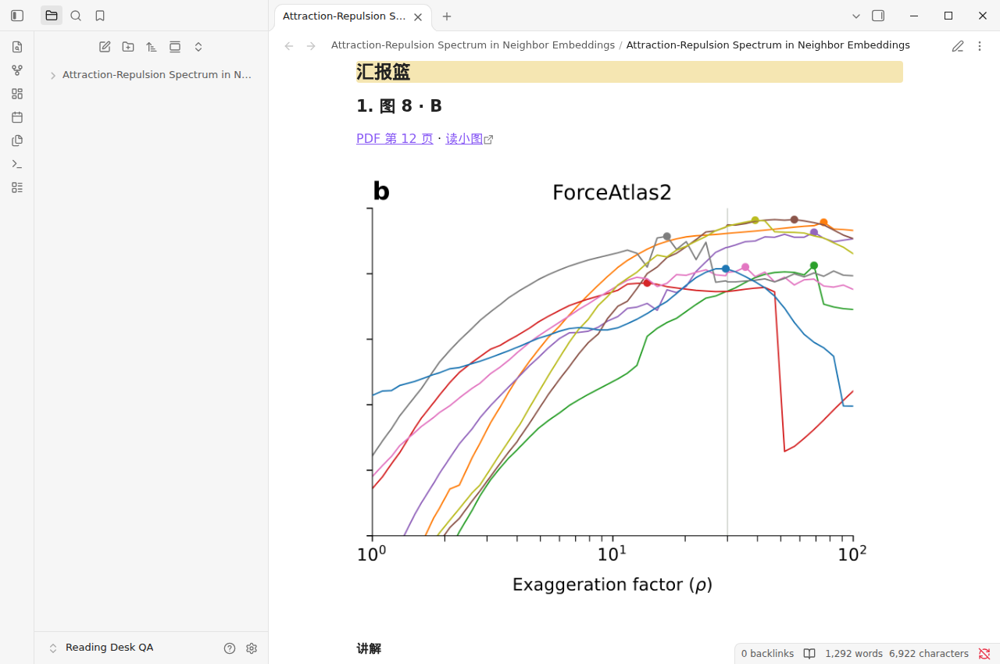

看手机上的两步实拍

在图上方点「看图解」。再点横轴，就能看到夸大系数怎样影响近邻之间的吸引力。

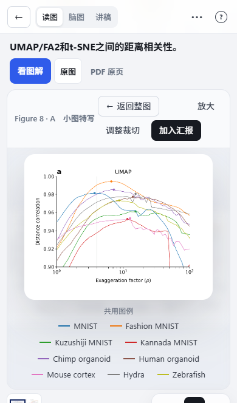 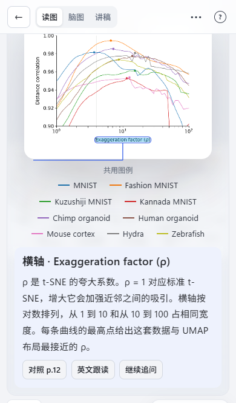

准备组会时，最费时间的往往是三件事。图放进 PPT 后坐标字糊了，查完一个陌生方法又忘了自己在看哪组点，最后每张图都读过，却讲不清它们之间的关系。下面用同一篇公开论文演示怎样取图、在图旁追问，再把这张图放回全文里理解。

[看分段演示](https://zhoy0409-debug.github.io/paper-reading-desk/?lang=zh) · [看配音宣传片](https://zhoy0409-debug.github.io/paper-reading-desk/film/zh.html)

在小图特写里点「调整裁切」，拖动边或角可保留坐标、图例和标尺。点「应用裁切」回到小图。已经入篮的图也可直接点「裁切」，缩略图和导出会使用新边界。

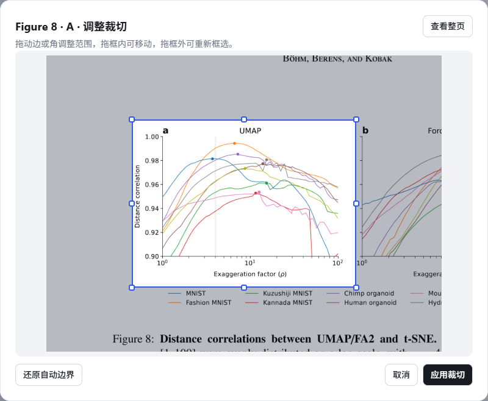

在小图特写里点「加入汇报」，原图缩略图就会出现在页面底部的「汇报篮」里。

第一次用，可以在阅读器点「公开论文试读」。也可以直接拖入自己的 PDF，文件由当前设备上的浏览器读取。[打开阅读器](https://zhoy0409-debug.github.io/paper-reading-desk/read/?lang=zh)

## 怎样从一张图回到全文，再把它讲给别人听？

上传时可让「学科词库」自动识别，也可手选。选择「我的词库」后，每行填一组「英文 = 中文」，点击「应用词表」。这份词表可在同一浏览器重复使用，每篇论文记住自己的学科选择。阅读中可从「论文与工具」修改。划词翻译和中文脑图使用同一套术语。个别节点未加载时，点旁边的「重试此处」。如果作者把两张小图合写在一句里，点页码能核对这句完整的原文。

在小图特写里，点蛋白变体标签可以读到位点编号和两种氨基酸的名称。显微图标出了处理行和野生型参照列时，点「继续追问」会直接解释应该比较哪两张照片。可以接着问字母的含义，也可以换一个标签继续读。

读图时，桌面左边是论文脉络，中间是原图，右边是解读。点小图进入特写，下方的缩略图标出它在整图中的位置。点坐标、图例或标尺，解释会自动进入视野。往下滚动可以读完说明、核对原文、继续追问。

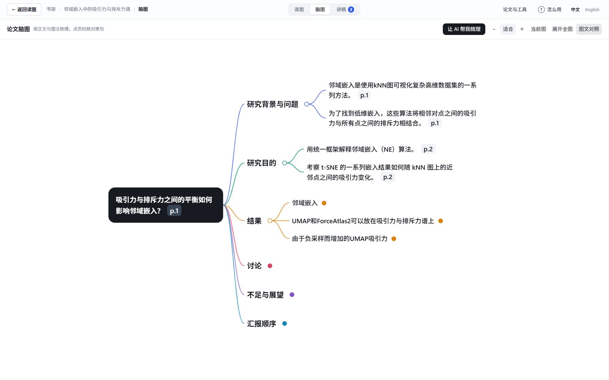

黑框点明本文研究的是哪种机制、哪项效果或哪两个对象之间的差异。背景讲研究缘起，目的分支列出作者具体考察了什么，结果分支展开到对应图、分图和正文。点「只看脑图」可展开画布，点页码可对照原句。划选英文图注后点「译为中文」，可逐句核对术语、数值和处理条件。

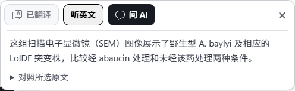

点「展开全图」可看各层分支，点「当前图」可读到这张图对应的结果和分图说明。网页版和 Windows 版都能用自己的 API Key 生成大纲，逐条核对引文。[看图 8 与原文证据的对照画面](docs/guide/studio-map-figure-zh.webp)

点底部「编辑讲稿」，同一批小图、排序和讲解会出现在整套幻灯片中。可加自己的图片和文字页，分别编辑投影片正文与演讲备注，试讲后点击「导出整套 PPTX」。

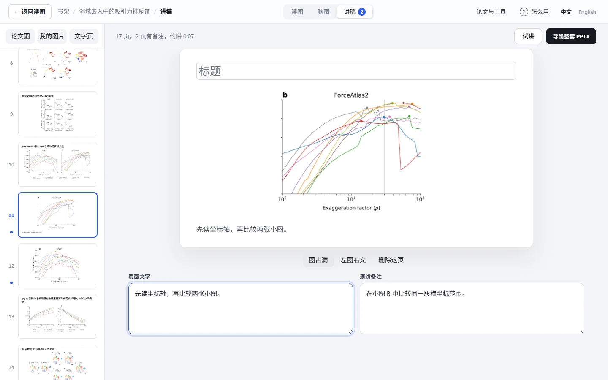

## 做 PPT 时，怎样直接取到清晰的小图？

拖动卡片左上角的手柄安排出场顺序，在缩略图旁直接写讲解，然后点「导出所选图」。幻灯片按篮中顺序排列，每张图下都有可编辑的讲解和来源页码链接。在同一浏览器重新打开这份 PDF，仍可接着编辑。

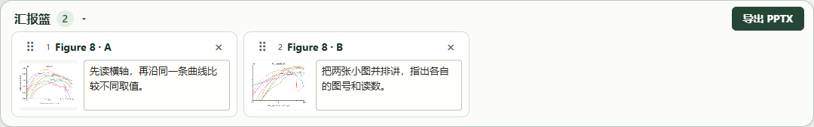

单独取图时，可在「裁切与汇报」里点「保存小图 PNG」。

[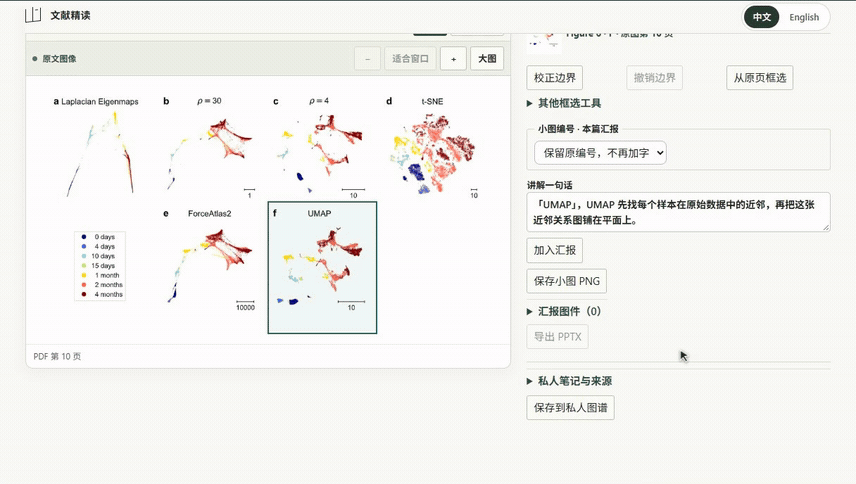](https://zhoy0409-debug.github.io/paper-reading-desk/?lang=zh#export)

[看可暂停的取图演示](https://zhoy0409-debug.github.io/paper-reading-desk/?lang=zh#export) · [看实际导出的 PNG（1243 × 1500）](dist/media/tour/sample-panel.png) · [下载可编辑的示例 PPTX](https://raw.githubusercontent.com/zhoy0409-debug/paper-reading-desk/refs/heads/main/docs/guide/figure-6f-zh.pptx)

裁边、改编号和组合多张小图

- **校正边界。** 可以调整自动选区、撤销上一步，或回到原页新框一块区域。原图和图注分居两页时，界面分别标出页码。
- **处理共享标注。** 可以把共用的图例、纵轴或组标题带进幻灯片，拆出的小图仍有解释数据所需的上下文。
- **安排汇报。** 点 × 移除小图。用键盘时，选中拖动手柄后按左右方向键即可换序。来自同一幅图且共用标注一致的相邻小图，每两张在一页并排呈现。编号可沿用论文，也可为汇报重新编号并保留原图对应关系。
- **区分讲稿和笔记。** 幻灯片标题和讲解可在 PowerPoint 中编辑，小图以图片插入。自己的疑问可另存为私人笔记。可以附上公开原文链接，示例幻灯片的出处直接打开 PDF 第 10 页。

## 不看图注，我能讲出这张图吗？

在论文脉络里选一张图，打开「盲读」，图注、图题和讲解会先盖住。写一句话，点「揭开图注」对照，再标出自己说中了多少。图只能整页显示时，页面上印着的图注盖不住，界面会直接说明。

打开「讲稿」可逐页编排和试讲。试讲视图提供计时和可展开的备注。

把小图加入汇报篮时，这句话会成为它的讲解，并保持同步，直到你手动修改讲解。手写的讲解不会被覆盖。在阅读器里按 `?` 可查看快捷键。

## 全英文汇报时，药名怎么念？

选中英文药名或图注，点**听英文**。读图时也可以从**英文跟读**打开当前小图的英文讲解，先听整句，再按慢速跟读。想练答辩，点**查背景与练答辩**，所选术语和这张图的依据会带入提问框。

[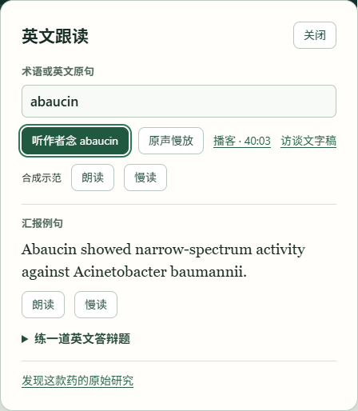](https://zhoy0409-debug.github.io/paper-reading-desk/read/?lang=zh&practice=abaucin)

[听研究者 Jon Stokes 念 abaucin，再练一句汇报用语](https://zhoy0409-debug.github.io/paper-reading-desk/read/?lang=zh&practice=abaucin)。作者原声取自美国化学会播客约 40:05，可重听或慢放。其他英文词句可用设备语音跟读，短词还可打开词典查发音。

## 读到陌生方法，能在原图旁弄懂吗？

点整图里的小图、右侧字母或裁切缩略图，都能进入特写。打开「裁切与汇报」时仍可点图内元素。实际画框时会切回原图，完成或取消后回到特写。

并排的坐标图可以分别打开。点轴名看指标和刻度，点图例中的色标或名称看对应组别。双纵轴图会标明该读哪一侧。可以上传 [DenseNet 的图 3](https://arxiv.org/pdf/1608.06993#page=6) 或[随机深度网络的图 4](https://arxiv.org/pdf/1603.09382#page=9)，在放大和调整裁切后再点同一个标签。

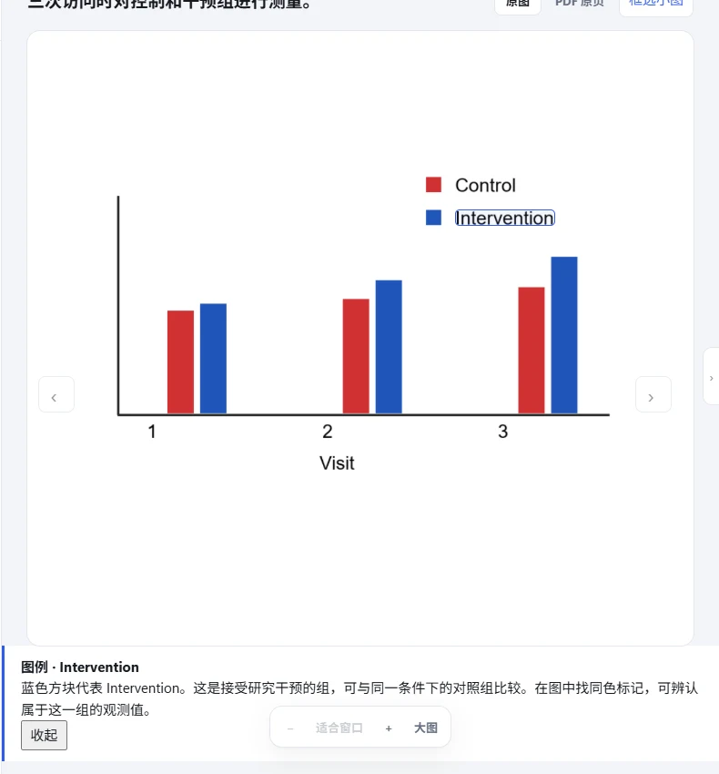

图 6F 的标签是 UMAP。先点小图看每个点代表什么、应当比较哪些点群，再选中图注里的取样描述追问「这些细胞的取样跨了多久？」。原文导读给出从第 0 天到第 4 个月的范围，点出处就能核对作者的原句。

[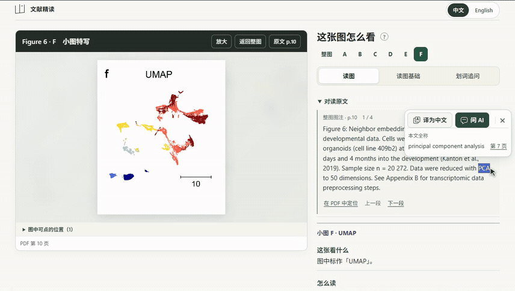](https://zhoy0409-debug.github.io/paper-reading-desk/?lang=zh#ask)

[看 UMAP 读图演示](https://zhoy0409-debug.github.io/paper-reading-desk/?lang=zh#methods) · [看划词追问与出处](https://zhoy0409-debug.github.io/paper-reading-desk/?lang=zh#ask)

[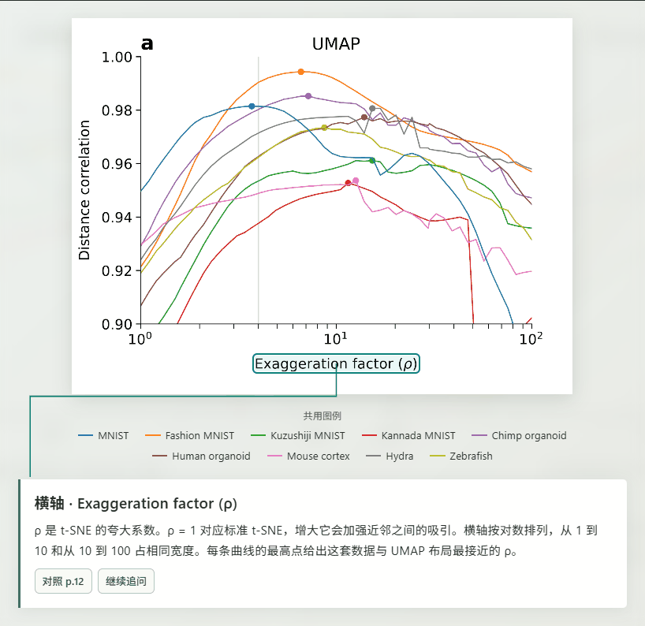](https://zhoy0409-debug.github.io/paper-reading-desk/read/?lang=zh&sample=figure-8a)

[在图 8A 亲手试：横轴、图例和曲线最高点](https://zhoy0409-debug.github.io/paper-reading-desk/read/?lang=zh&sample=figure-8a)

点图上的轴、组名或标注，会看到什么？

[查看静态截图](docs/guide/focus-zh.png)

- **一处一点。** 试读论文图 8A 中，点横轴看 ρ 如何改变近邻的吸引，点图例选一套数据，点曲线最高点看该数据在哪个设置下最接近 UMAP。点空白处或按 `Esc` 收起，也可以直接返回整图。
- **按图型读。** 在支持的图中可以了解横纵轴和单位、颜色和图例、曲线与观测点的对应关系。病理精读示例还会带读者找组织结构，并从代表性视野转到损伤评分。
- **弄清为什么这样设计。** 当原文给出线索时，可查看研究对象、分组、对照及干预先后。比如先干预后观察和先出现损伤再治疗，两个终点回答的问题不同。已覆盖的动物品系还可查看品系资料与同类研究。
- **追问具体选择。** 想知道为什么选某个对照药、某个指标，可以从这张图查到方法、作者引用的文献或其他研究。讲解会标明依据来自哪里。
- **划词有两个入口。** 可以只翻译所选文字，也可以带着图号和原文提问。查缩写时，能在本文找到的全称优先显示。帮助提示可用鼠标悬停、键盘聚焦或触屏点按查看。

这次提问要查到哪里？

从当前选段开始，按问题选择检索范围。

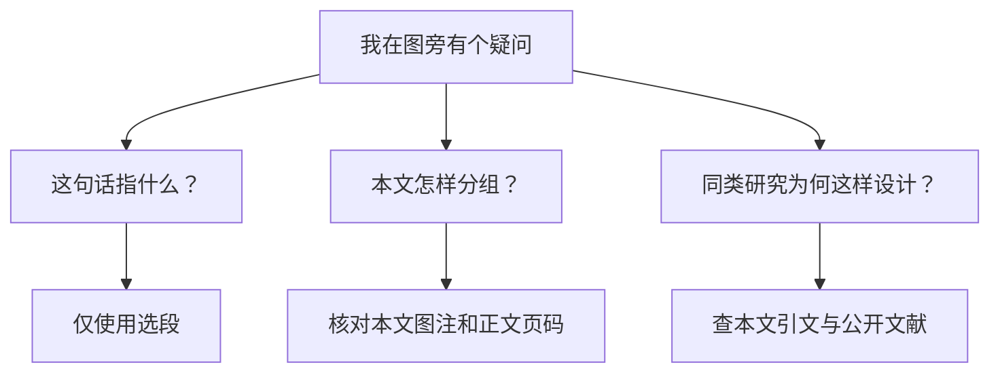

发送给模型前可核对或编辑选段，查看附带的出处及追问记录。公开检索支持修改主题词。已与本文参考文献表核对的条目，会标出引用关系。

## 每张图都看过了，怎样讲清全文？

打开论文图谱，先读中心的研究问题或作者在摘要中的表述。点一条分支，找出这项结果对应的图，再展开到小图，回到原页核对。中文版会生成中文题名、分支和小图说明，随时可以切回英文看原文。

[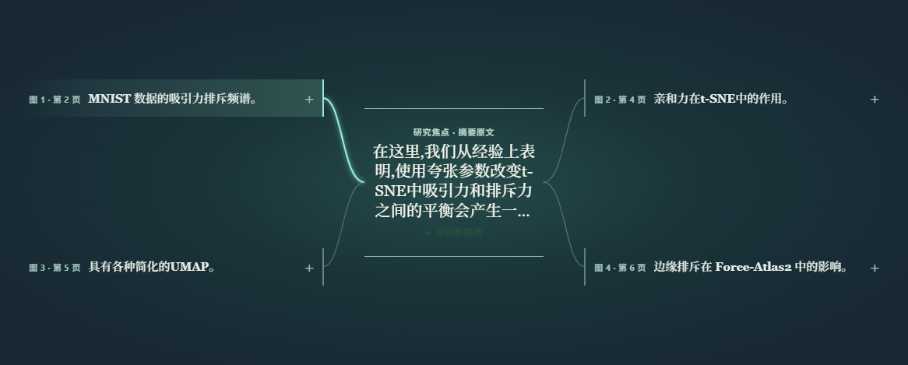](https://zhoy0409-debug.github.io/paper-reading-desk/read/?lang=zh)

[看图谱操作演示](https://zhoy0409-debug.github.io/paper-reading-desk/?lang=zh#story) · [在中文版中试读](https://zhoy0409-debug.github.io/paper-reading-desk/read/?lang=zh)

换一篇论文、添加补充材料或下次接着读

- **导入新文献。** 主文支持 PDF、DOCX、TXT，也可粘贴正文或图注。补充材料、参考文献可分别指定角色。PDF 提供原图定位和裁切，扫描页可手动定位。
- **选择读法。** 用图谱看全篇，用小图特写看细节，用原文索引按章节、图号或引用跳读。新论文从可识别的版面、图注和正文生成导览；逐图整理过的示例另有专门的方法与实验设计讲解。
- **核对证据。** 小图专属图注和多图共用的段落分别标识。点出处进入 PDF 页，能匹配到原句时会标出所在行。
- **保留阅读位置。** 在同一浏览器可重开已保存的论文、笔记和裁切位置。私人图谱可记录已核实的论文间引用、标题主题线索及自己补充的联系。
- **复用查过的文献。** 本机浏览器保存已检索的公开书目。模型背景资料的 30 天间隔用于检查更新，书目在此后仍可查看。

## 选择使用方式

| 功能 | 网页版 | Windows x64 便携版 |
| --- | --- | --- |
| 开始阅读 | 打开网页即可，免安装、免账号 | 完整解压 ZIP，双击 `start.cmd`。已包含 Python |
| 中文或英文图谱、小图特写、PNG 和 PPTX 导出、原文导读 | 支持 | 支持 |
| 公开文献检索 | Crossref、Europe PMC，支持 PMID 精确检索 | PubMed、Crossref |
| 沿用自己的 AI 网页 | 复制问题和原文，可打开 ChatGPT、DeepSeek、Claude 或 Gemini | 同样支持 |
| 在阅读器内提问 | 原文导读，或使用自己的 DeepSeek、通义千问（北京）API Key | 同样支持，也可使用本机的 Ollama 或已登录的 Codex CLI |
| 获得新版 | 重新打开或刷新网页 | 点语言切换旁的「版本更新」，选择「下载安装」，完成后点「重启并应用」。旧版缺少此按钮时，关闭旧版并把最新 ZIP 解压到新文件夹，双击 `start.cmd` 打开 |

打开「划词追问」，在「回答方式」选 DeepSeek 或通义千问。在「使用自己的 API Key」里填入对应服务商的 Key，点「使用此 Key」。核对选段，勾选发送确认，即可在图旁提问。网页版由浏览器直连服务商，每次请求使用读者自己的模型额度。刷新或关闭标签页会清除网页里的 Key，Windows 版在退出阅读器服务时清除。两版都可以随时点「移除 Key」。

v0.2.2 及更早的便携版需先手动下载新版一次。[Windows 下载](https://github.com/zhoy0409-debug/paper-reading-desk/releases/latest/download/Reading-Desk-Windows-x64.zip) · [发布说明](https://github.com/zhoy0409-debug/paper-reading-desk/releases)

macOS 或 Linux 用户也可用 Python 3.8 或更高版本运行 `python3 preview.py` 启动本机服务。

示例来自 Böhm、Berens 与 Kobak 关于邻域嵌入的公开论文。演示使用原图裁切并添加界面标注。[原论文](https://www.jmlr.org/papers/v23/21-0055.html) · [图源、许可与组件说明](THIRD-PARTY.md)
