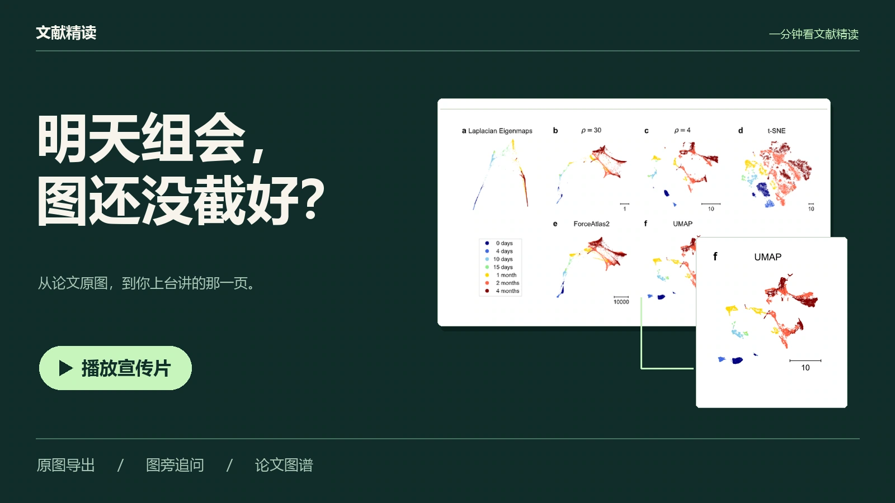
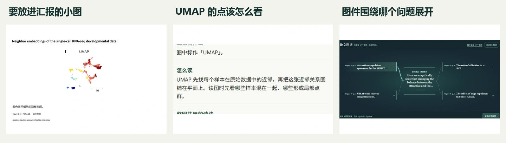

# 文献精读

[English](README.md) · [直接打开阅读器](https://zhoy0409-debug.github.io/paper-reading-desk/read/?lang=zh) · [一分钟宣传片](https://zhoy0409-debug.github.io/paper-reading-desk/film/zh.html) · [观看操作演示](https://zhoy0409-debug.github.io/paper-reading-desk/?lang=zh)

做一次文献汇报，时间常花在这些地方：为了把图放上 PPT，一张张放大、截图、裁边。遇见陌生的方法，查了半天资料还没回到原图。等每张图都看完，又得重新梳理作者为什么接着做下一个实验。

[看一分钟宣传片](https://zhoy0409-debug.github.io/paper-reading-desk/film/zh.html) · [按阅读问题浏览全部功能](https://zhoy0409-debug.github.io/paper-reading-desk/film/zh.html#features)

| 读论文时遇到的事 | 打开论文后可以怎么做 |
| --- | --- |
| **每张图都要单独截，放到 PPT 上字还是糊的。** | 点选小图，直接从原 PDF 裁出 PNG。也可以写一句讲解，连同图号、页码一起导出为 PowerPoint。[看取图过程](https://zhoy0409-debug.github.io/paper-reading-desk/?lang=zh#export) · [打开实际导出的 1243 × 1500 小图](dist/media/tour/sample-panel.png) |
| **为了看懂 UMAP 查了好几页资料，回来还是不知道这团点该怎么看。** | 小图旁就能读到方法原理和观察位置。遇到 PCA 可划词查本文全称，图注里的取样时间也可直接追问并回到出处。[看方法解读](https://zhoy0409-debug.github.io/paper-reading-desk/?lang=zh#methods) |
| **单张图能看懂，轮到我汇报，却讲不清几张图是什么关系。** | 展开论文图谱，先看研究问题和各图在文中的位置，再点进一张图核对小图和作者的表述，挑出汇报要用的证据。[看图谱怎样串起全文](https://zhoy0409-debug.github.io/paper-reading-desk/?lang=zh#story) |

## 开始使用

**网页直接用。** 打开阅读器，点「公开论文试读」，或选入自己的 PDF。读图、导出和原文导读都免安装、免账号。PDF 由你设备上的浏览器处理。[打开中文版](https://zhoy0409-debug.github.io/paper-reading-desk/read/?lang=zh)

**Windows x64 便携版。** 下载 ZIP，完整解压，双击 **start.cmd**。运行环境已随包附带。需要在阅读器内接入模型时使用这一版。[下载 Windows 便携版](https://github.com/zhoy0409-debug/paper-reading-desk/releases/latest/download/Reading-Desk-Windows-x64.zip)

## 怎么提问

- **直接问原文。** 划选文字，围绕当前小图提问，再从答案回到对应页。需要背景资料时可展开公开检索。网页版查询 Crossref，本机版还支持 PubMed。
- **已有常用 AI 网页。** 点「用已有的网页版 AI 继续问」，复制问题和原文，再粘贴到自己使用的服务。
- **想在本机阅读器里直接得到模型回答。** 展开「回答与检索设置 → 连接自己的模型」，选 DeepSeek 或通义千问（北京），粘贴相应的 API 密钥，点「使用密钥」后即可提问。密钥只存于本次服务进程内，可手动移除，关闭服务即清除。API 使用及计费由服务商管理。
- **已安装 Ollama 或 Codex CLI。** 本机版可检测已有的 Ollama 模型和 Codex CLI。选择 Codex 时使用自己的已登录账号。

macOS 或 Linux 如需从源码运行本机服务，可用 Python 3.8 或更高版本运行 `python3 preview.py`。示例论文和组件的来源见[第三方资料说明](THIRD-PARTY.md)。
